# Builder Track Weekly Report, Week 9

**Name:** Karas  
**Period:** 10–16 October 2026  
**Project:** Nine Cells, a merge tower defense game ([game source](https://github.com/karasbuilder/nine-cells), [contract/report repo](https://github.com/karasbuilder/ckbuilder), [public demo](https://nine-cells.karasdev.com/))  
**Focus:** Review the playable frontend and the existing testnet integration, without counting earlier work twice.

## 1. Summary

Nine Cells has a playable browser loop and an on-chain CatCell Vault. In a fresh local run I connected the development-only fake JoyID wallet, opened level 1, entered the two-wave practice battle, deployed a Rookie, returned to the map, inspected the Vault and opened a simulated crate. The public demo loaded and reached its CKB wallet gate; I did **not** sign a live transaction or complete a public-wallet playthrough in this review.

## 2. Objectives and status

| Objective | Status at report preparation | Evidence / limit |
| --- | --- | --- |
| Frontend connected to CatCell script | Already done by week 7 | The Vault's CCC builders and testnet transactions are documented in [week 7](../week-07/report.md#5-practical-progress). Current local UI can be exercised with the fake provider; that is not a chain test. |
| Correct inputs, outputs, deps and witnesses | Previously tested, not reverified on testnet this week | Week 7's transaction hashes and week 8's 33-case devnet suite cover the existing script paths. No new week-9 transaction hash. |
| Usable rejection messages | Not independently verified this week | The week-8 CCC exit-code parsing problem is still an open issue; no screenshot of a real wallet rejection is supplied. |
| New testnet deployment and real-wallet full flow | No evidence of a new week-9 run | The linked Type ID deployment dates to week 7. The public browser stopped at wallet connect because it had no usable CKB wallet session. |
| CKBuilders group feedback / three external players | Not evidenced | No quotes, participant notes or group link found; do not count the local smoke check as outside playtesting. |

## 3. What the game already does

- **Battle:** five districts and a level map; level 1 opens a practice battle with a Rookie card, lane-based enemies, wall health, a deploy tutorial and add-ons. Buying, placing, moving and in-battle merging are local simulation, not signed transactions.
- **Collection:** Cats and Add-ons screens provide squad/loadout slots and upgrades; the Bestiary hides enemies until discovered. A cat line owned in a CKB wallet can unlock its battle card.
- **Vault:** CatCells are 8-byte typed cell data under the player's lock. The UI lists owned cats, details and locked capacity, offers 2/4/8 same-level merges, gifts and releases, and previews 1–5 crates before an explicit mint. A crate's line is determined from a later block header and checked by the type script, not chosen by the animation.
- **Fast mode:** an optional session wallet is funded once, then can sign repeated Vault actions without a popup and sweep cats/capacity back to the main wallet. The browser-stored session key carries a custody risk; it is not a replacement for the main wallet.
- **Limits:** battle wins are not verified on chain, so an open fixed-level mint does not prove a win. Week 8 also demonstrated that bulk mint → reveal → release can cheaply select a preferred line after the fact.

These are **product capabilities observed in source or the 17 October build**, not a list of features completed specifically in week 9. The game repo's latest committed change in the local checkout is `67d8373` (3 October, splash screen); the current worktree has uncommitted edits. There is no week-9 game commit range to cite.

## 4. Screen tour and play check

**Public demo — wallet gate.** After entering the public URL, the site displayed JoyID Passkey and UTXO Global Wallet choices. This proves the page loads and reaches wallet selection, not that the wallet signs or that the Vault works on the public build.

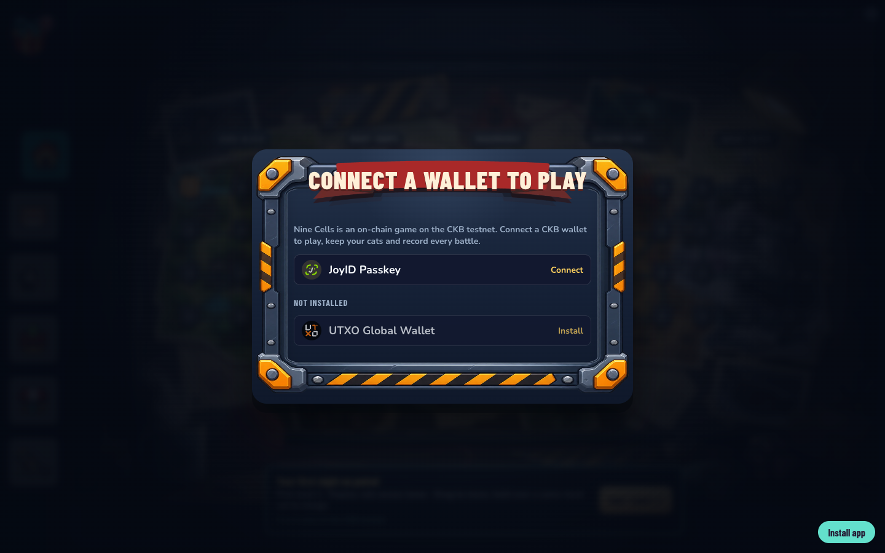

**Local development build — map and level selection.** `npm run dev` with `?fakewallet=1` connected a simulated JoyID wallet. From the fresh map I selected level 1 and saw the enemy, squad and add-on briefing.

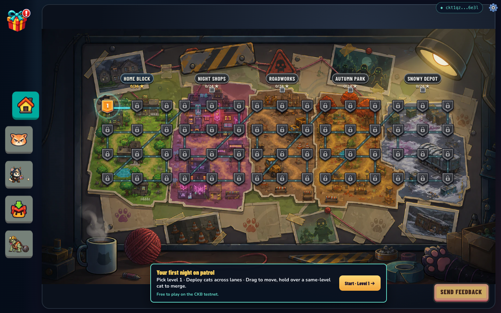
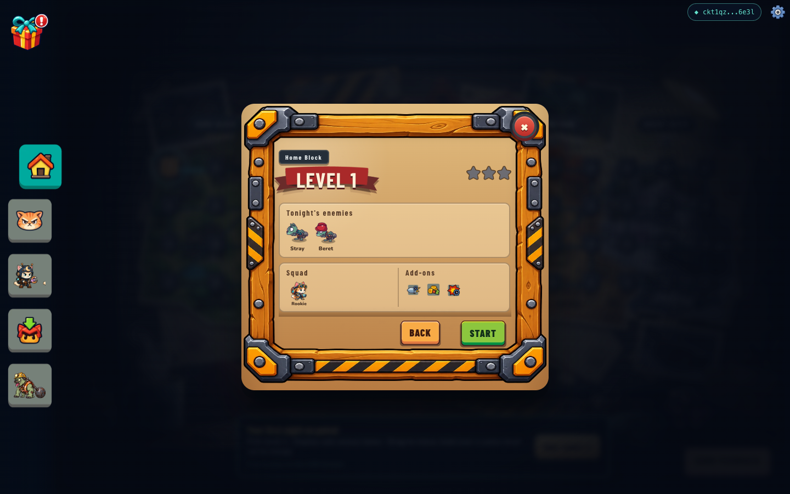

**Practice battle.** Starting level 1 loaded the Phaser battlefield; the HUD showed wave 1/2, deploy cost, wall and tutorial instructions. Clicking the Rookie card changed the tutorial from “tap the cat card” to the next drag instruction. I exited through Pause → Back to map; I did not claim a win.

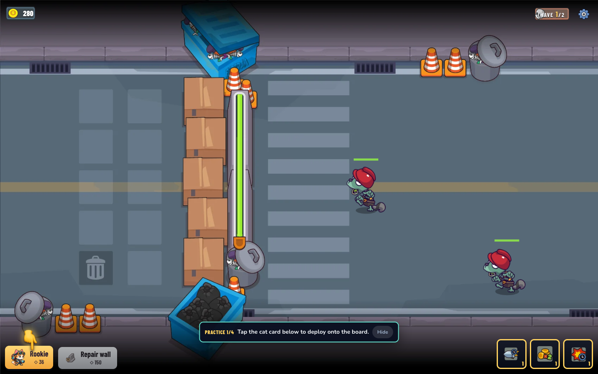

**Vault and CatCell data.** The fake provider seeded two cats. I opened Bandana's Details to inspect its level, role, line, mint block, capacity and combat stats. Its displayed fake block `#12000000` and `134 CKB` capacity are **simulation values**, not explorer evidence or a live cat.

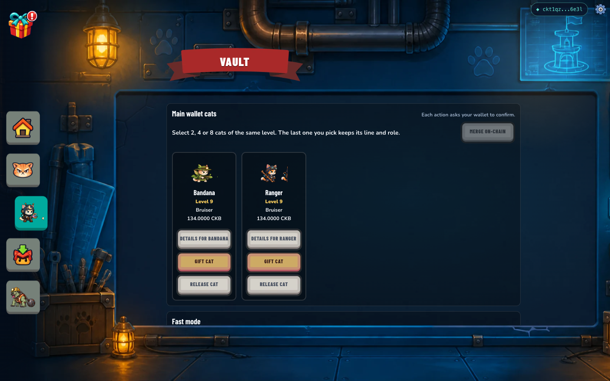
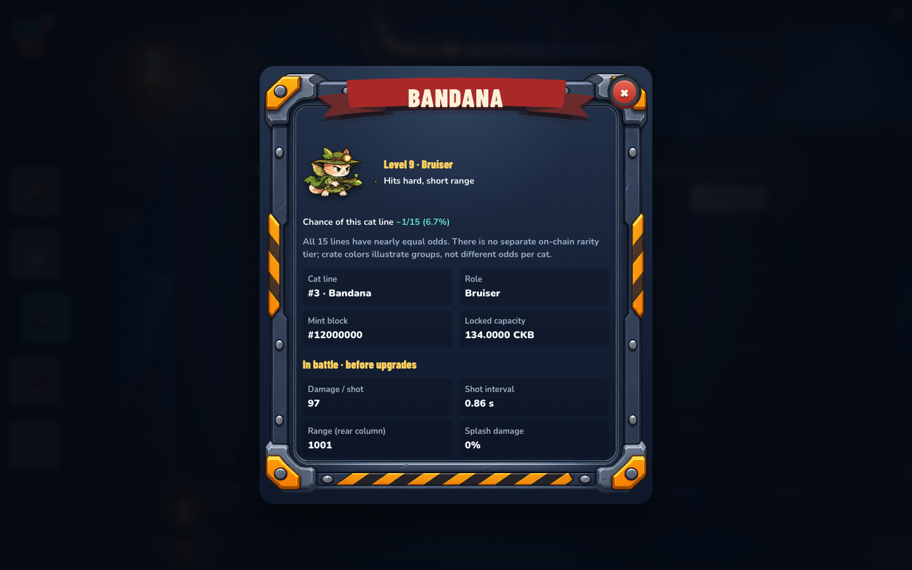

**Crate flow.** The Vault displayed fast-mode funding presets and 1–5 crate selection. “Open 1 crate” led to a preview that explicitly said no transaction starts until Mint is pressed. I pressed Mint **in fake-wallet mode** and observed a Topcat added to the Vault plus a reveal card. No CKB transaction was broadcast by this run.

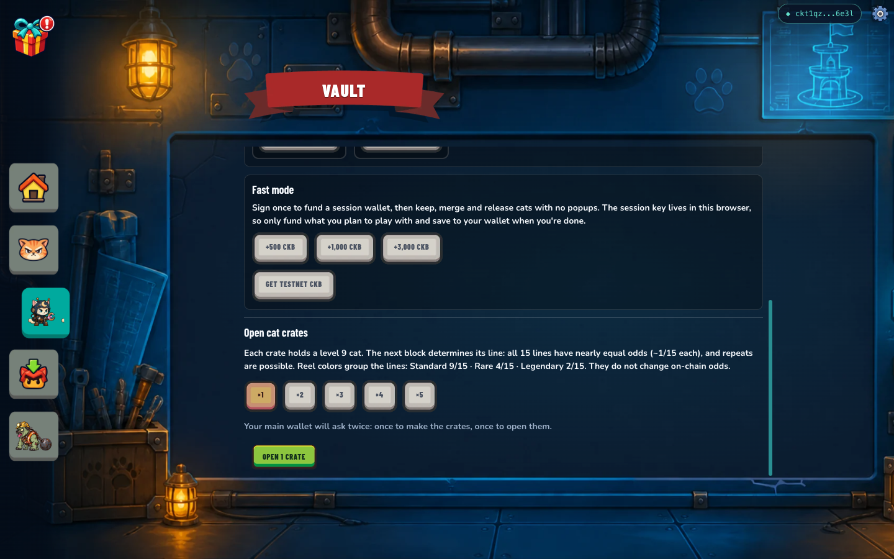
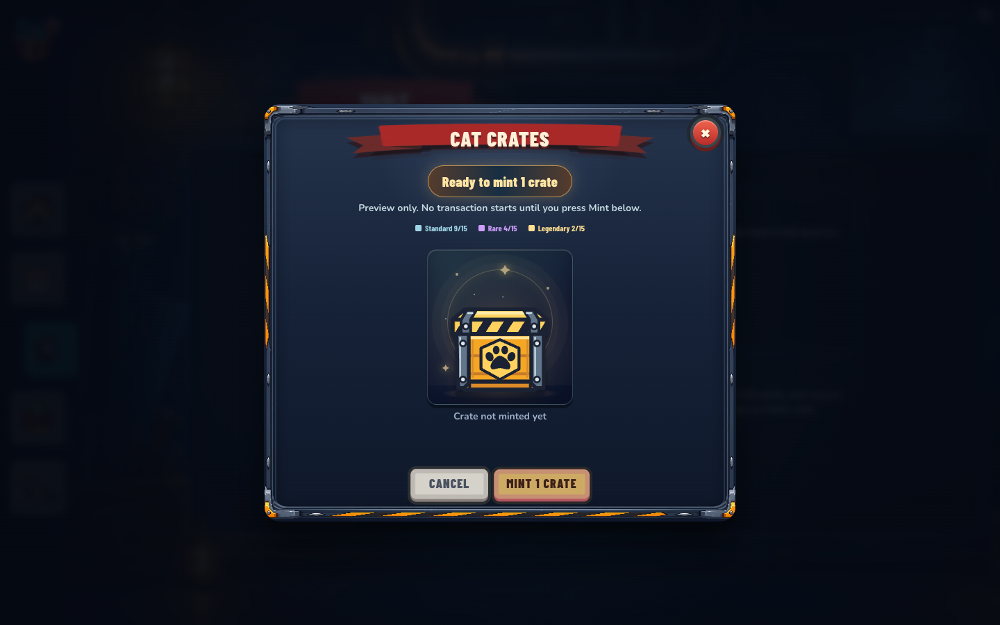
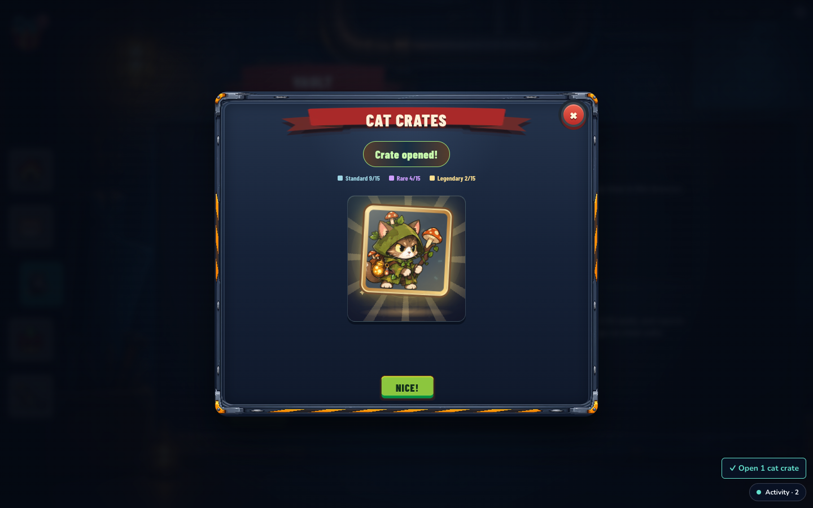

**Supporting screens.** The local Cats screen showed the Rookie squad slot and on-chain-tagged simulated cats; Add-ons showed three equipped abilities; the Bestiary began with undiscovered enemies. These are UI screens, not proof of on-chain ownership.

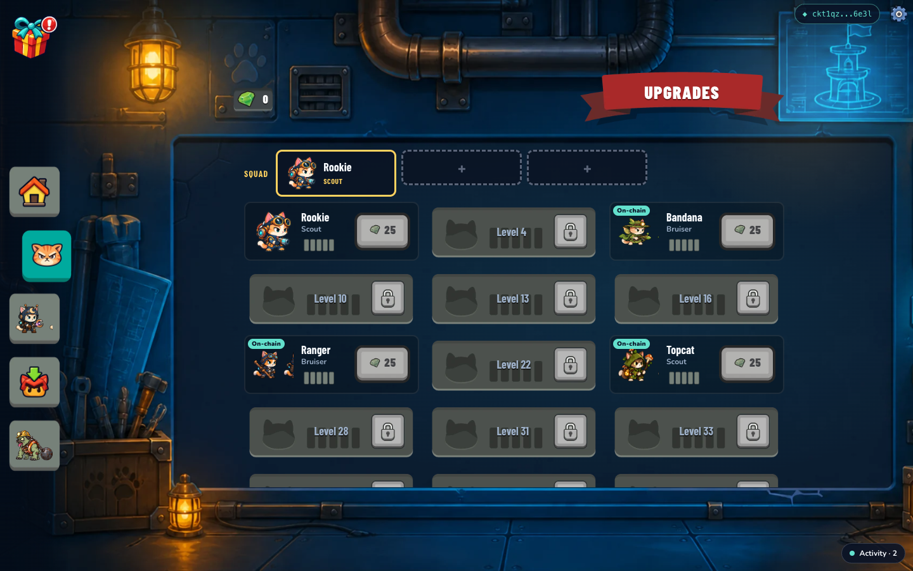
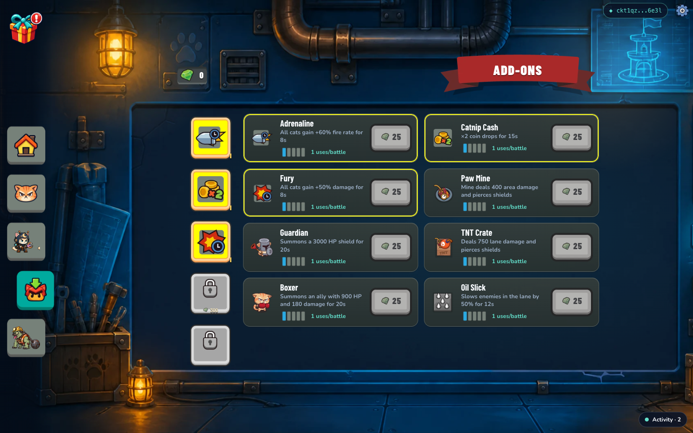
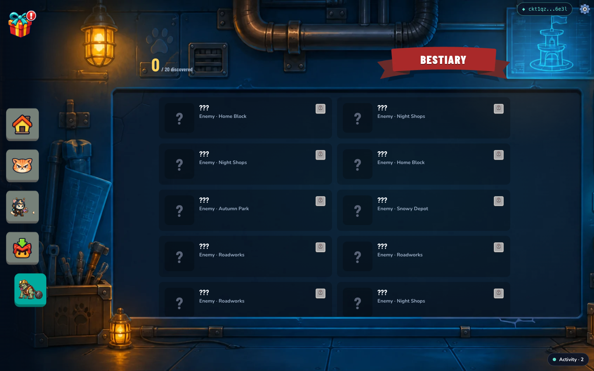

## 5. Chain evidence carried forward, not a week-9 deploy

The contract's Type ID is `0xbc7cc190ac166a31de875e6fc4b0571903d62c665c25a84ec4f971277dd4126d`. The v3.1 upgrade was already recorded in [week 7](../week-07/report.md#5-practical-progress): [deploy transaction](https://testnet.explorer.nervos.org/transaction/0x47c3f0edb11e41b0fb331405c9fb675b84b27b1ee3c82e01836798d5d5aa1d2e), [JoyID-signed mint](https://testnet.explorer.nervos.org/transaction/0x7837c23b01660ed6ceec313ac37ff45806c51b04a10036e3fba06f7381a23476), [crate reveal](https://testnet.explorer.nervos.org/transaction/0xdfa81fefc4bde23ba9739b6df9420c2772223165d5a5259539e28469bd21b963), [four-cat merge](https://testnet.explorer.nervos.org/transaction/0x355c4dbe2696b81e605728fa8add7b45f50e09a7714eb7a8b414d662f3221e0b) and [session-wallet sweep](https://testnet.explorer.nervos.org/transaction/0x33f8a5349d468d1d038e466b4b0c29287a1050c033d2727b4d05221e8c1185db).

The latest node-level rejection evidence remains [week 8](../week-08/report.md#5-practical-progress): 33 devnet tests, including 30 rejected transactions. Local devnet hashes do not have public explorer pages. Screenshots of a fake-wallet reveal cannot extend that testnet evidence.

## 6. Verification on 17 October

On the current local checkout, `NODE_ENV=test npm test` passed **446 tests in 33 files**; the 8 real-node devnet tests were skipped. `npm run build` passed (`tsc -b` and Vite). jsdom printed a canvas `getContext()` warning, and Vite warned about chunks over 500 kB; neither stopped this run. These results verify the **current worktree**, not a frozen 16 October build or a public-wallet transaction.

The browser check covered the public wallet gate and the local fake-wallet map → level briefing → battle deployment → Vault details → crate preview → simulated reveal. It did not cover winning level 1, a real wallet, or testnet broadcast.

