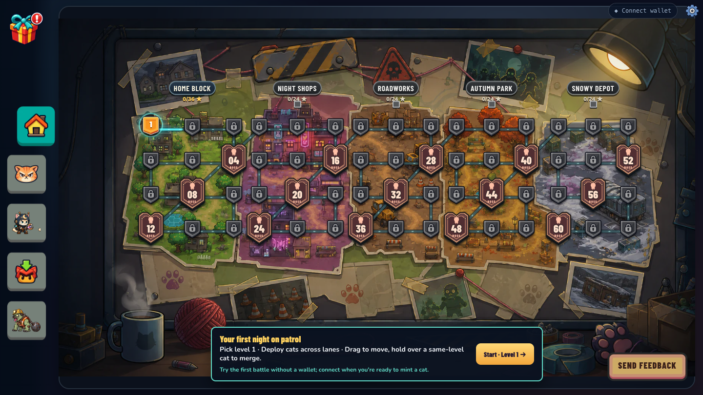
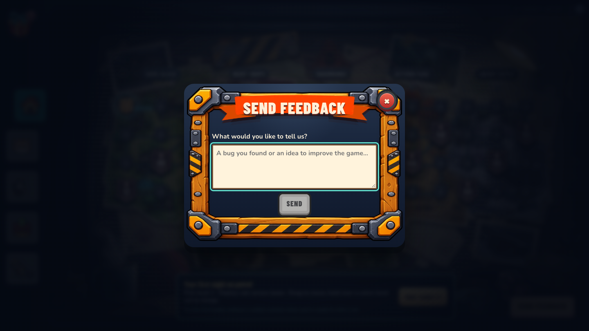
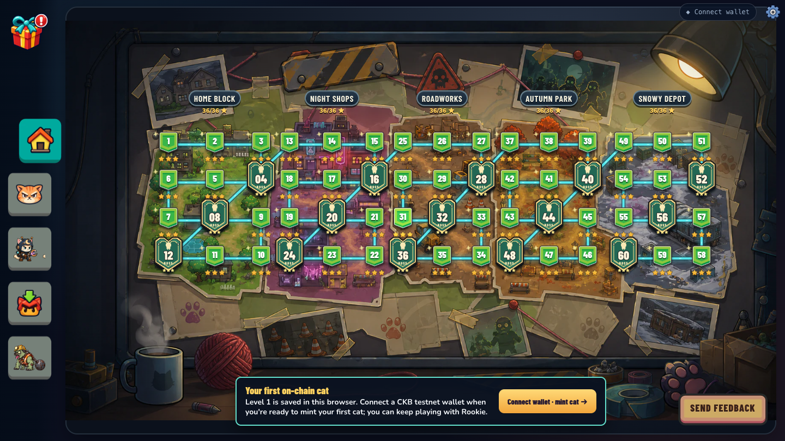
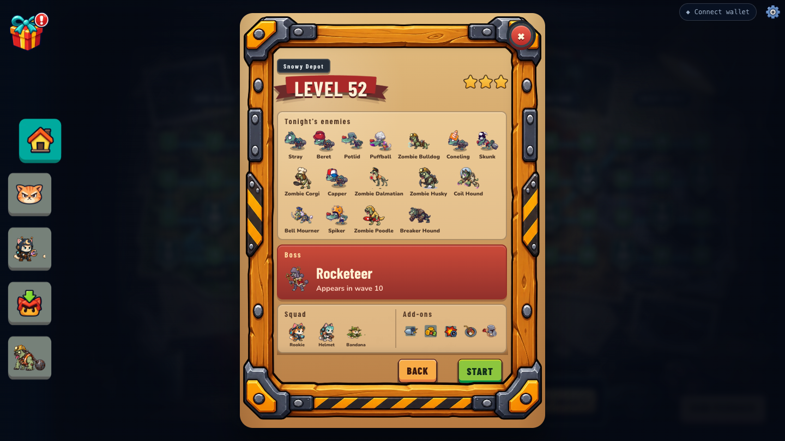
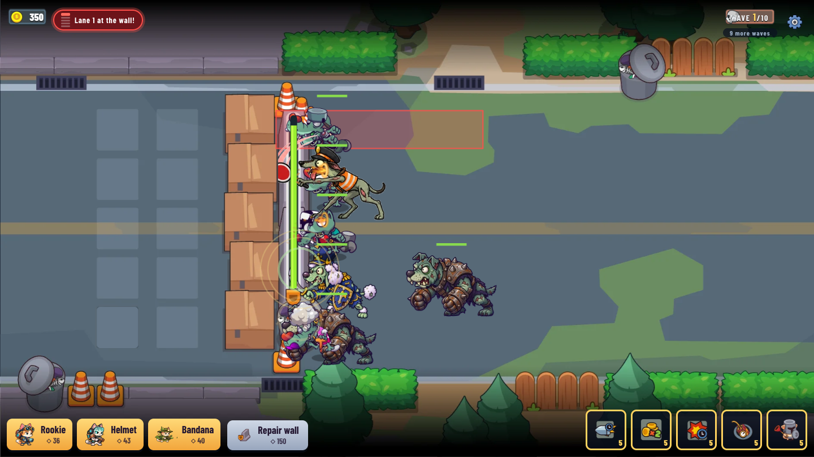
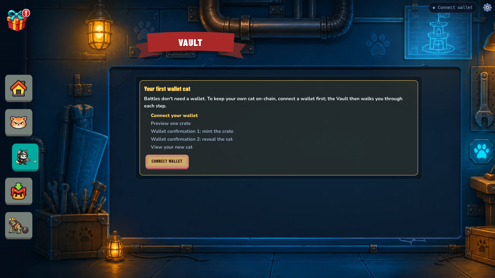
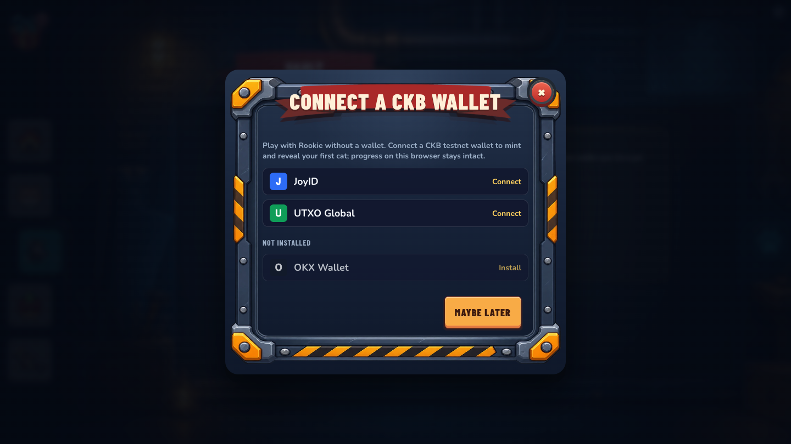
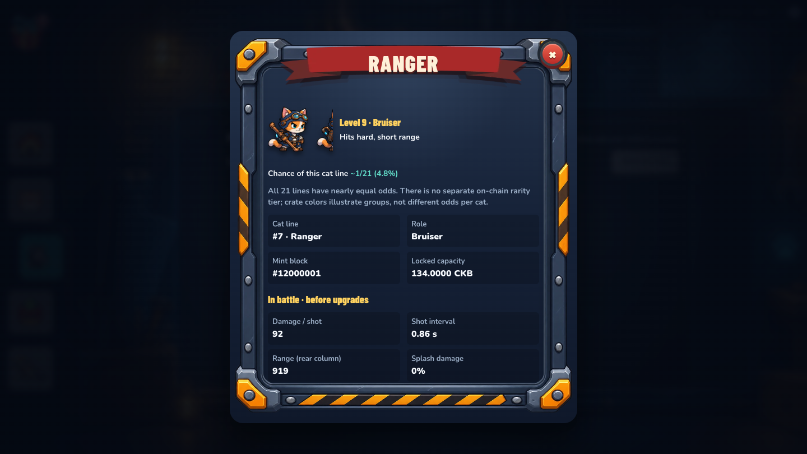
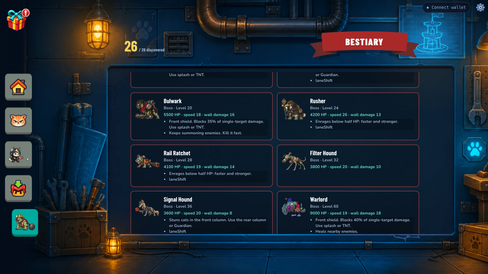
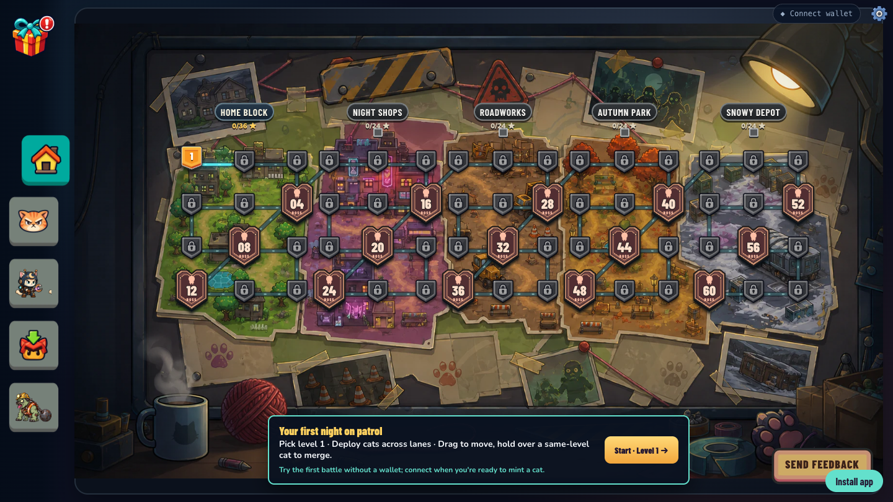

# Builder Track Weekly Report, Week 10

**Name:** Karas  
**Period:** 17-24 October 2026  
**Project:** Nine Cells, a merge tower defense game [public demo](https://nine-cells.karasdev.com/)
**Focus:** Get the game ready for outside players: drop the wallet wall, add a feedback channel, give battles music and bosses, and widen the on-chain cat pool from 15 to 21 lines.

## 1. Summary

This was a game week. I shipped four commits to the game (18, 19, 20 and 23 October) and kept working on bosses and new enemies on 24 October. The biggest change for new players is that **a wallet is no longer required to play**. Battles, XP and gems work without one; the wallet is only needed to mint, reveal and manage CatCells. Players can now send feedback straight from the map into a Google Sheet.

On chain, I upgraded the CatCell type script to **v4** on testnet on 23 October. A crate now reveals one of **21** cat lines instead of 15. The Type ID did not change, so existing cats stay valid.

The public demo is updated: the live bundle contains the boss crests, the feedback form, the optional wallet modal, the 1/21 odds text and the new bosses.

## 2. What I did this week

| Date | Commit / source | What changed |
| --- | --- | --- |
| 18 Oct | `0008127` upgrade: script and feedback UI | **Send feedback** form (Vietnamese/English) posts to Google Sheets via Apps Script (`tools/feedback.gs`). Sends only the message and language, no wallet address or save data. Reworked first-clear result dialog and map prompt that point a new player to the first crate. Vault shows **Checking wallet cats…** instead of a false empty list; an unopened crate resumes after reload. Shop removed for now; gems still work for upgrades. |
| 19 Oct | `c0e35f6` upgrade audio | Adaptive battle music: three synced 16-bar loops per district (**normal**, **pressure** on the last wave, **boss** while the boss is alive), 15 tracks in total. Seven new SFX (deploy, shoot, merge, wave, boss, win, lose). Boss-wave alert with portrait and name. HUD shows waves left and the threatened lane; holding a cat over a same-level cat shows a **Release to merge** cue. Wallet made optional for battles. |
| 20 Oct | `daeb174` update: balance | **Boss crest** on every fourth map node (locked, ready, cleared states). **Zombie Dalmatian** gets an acid throw in later waves of districts 4-5: it marks two tiles, gives a 3-second warning, then slows cats' fire rate by 50% for 2.5 s. Killing it during the warning cancels the throw. New acid VFX and impact sound. Public demo redeployed to Cloudflare Pages. |
| 23 Oct | `5d6feb0` + uncommitted | Game: `MAX_SKIN_ID` and reveal math moved from 15 to 21 lines, Vault and crate reveal updated. Contract: CatCell type script v4 (21 lines), built and deployed to testnet (section 4). |
| 24 Oct | uncommitted, already on the live demo | Three new bosses (**Rail Ratchet**, **Filter Hound**, **Signal Hound**, now 10 in total), a `laneShift` boss ability, three new enemies (**Coil Hound**, **Bell Mourner**, **Breaker Hound**), redrawn boss art. Skins now unlock only by on-chain ownership, not by player level. Cat upgrade step reduced from +8% to +5% damage per tier. |

**Bug fixes in the same commits:**

- **Vault showed spent cats after a merge, gift or release.** The indexer can return the old cells for a moment after a transaction commits. Cats in a pending transaction now stay locked with a confirming label, a committed transaction removes them at once, and a rejected one unlocks them for retry (18 Oct).
- **A failed chain read looked like an empty wallet.** The Vault used to show "no cats" or spin forever when the cat query failed, which pushed owners toward minting again. It now shows an error with **Retry** and recovers the list (19 Oct).
- **Mint that never confirmed.** The Vault now says "Transaction not confirmed. Check Activity before retrying" instead of inviting a blind second mint (19 Oct).
- **Feedback lost on a network error.** The message stays in the form so the player can resend (18 Oct).
- **Result dialog clipped on short landscape screens.** It now scrolls so the reward and action buttons stay reachable (19 Oct).

Design notes I wrote alongside the code are in the game repo's `docs/` folder: difficulty plan (20 Oct), boss art and in-game boss reports (23 Oct), boss gameplay, boss walk motion, cat stats framework and monster art review (24 Oct).

## 3. Screens

All local screens were taken on 24 October from the dev build (`?fakewallet=1`, plus `showcase=1` to unlock levels). The fake wallet signs nothing; these screens show the UI, not on-chain results.

**Map without a wallet, with boss crests.** A new player lands on the map, not on a wallet gate. The hint says the first battle needs no wallet. Every fourth level is a boss crest, and **Send feedback** sits bottom right.

**Feedback form.**

**Cleared map and first-cat prompt.** With all levels cleared, boss crests turn green and gold. A player with no wallet cat is reminded to connect and mint, but can keep playing with Rookie.

**Boss level briefing.** Level 52 (Snowy Depot) lists the new enemies (Coil Hound, Bell Mourner, Breaker Hound) and the boss wave.

**Acid throw and lane HUD.** The Zombie Dalmatian marks lane 1 in red before throwing. Top left, the HUD warns **Lane 1 at the wall!**; top right shows **9 more waves**.

**Wallet is optional.** The Vault explains the first-cat steps (connect, preview, mint, reveal, view). The wallet modal now has **Maybe later**.

**Cat details after the v4 upgrade.** Each line now shows ~1/21 (4.8%). The mint block number here is from the fake wallet.

**New bosses in the Bestiary.** Rail Ratchet, Filter Hound and Signal Hound next to the older bosses.

**Public demo, 24 October.** The live site opens straight to the map with boss crests, the no-wallet hint and Send feedback.

## 4. On chain: CatCell type script v4

| Item | Value |
| --- | --- |
| Change | Reveal picks `1 + u32le(seed) % 21` instead of `% 15`; `MAX_SKIN` 15 → 21. Seed is still blake2b(next block nonce ‖ transactions_root ‖ crate outpoint). |
| Type ID (unchanged) | `0xbc7cc190ac166a31de875e6fc4b0571903d62c665c25a84ec4f971277dd4126d` |
| Deploy tx | [`0x700b17fb…609c6d`](https://testnet.explorer.nervos.org/transaction/0x700b17fb61ccb4f924609f2d3be680f9db7dda04e482ba1ff1d3fedf2e609c6d), committed in block 22,837,963 on 23 Oct 2026, 22:50 (UTC+7) |
| Code cell data hash | `0xc39cb169d3f7d384de4e3a8e5a645f468ff28c134dddae6d7d180d43bd82a0c5`; matches `hashCkb` of the local `dist/nine-cells-cat.bc` |
| Previous code cell | [`0x47c3f0ed…5aa1d2e`](https://testnet.explorer.nervos.org/transaction/0x47c3f0edb11e41b0fb331405c9fb675b84b27b1ee3c82e01836798d5d5aa1d2e) (v3.1, week 7) |

Because the cat type script is referenced by Type ID, old cats (lines 1-15) stay valid and need no migration. The mock and devnet tests were updated to `% 21`.

I don't have a new mint or reveal transaction against v4 yet, so I am not claiming one. The week-7 transactions are still the latest wallet-signed evidence.

## 5. Verification on 24 October

| Check | Result |
| --- | --- |
| Game tests (`vitest run`) | **483 passed**, 8 skipped (real-node devnet tests), 38 files |
| Game build (`tsc -b && vite build`) | Passed |
| Contract mock tests (`jest tests/nine-cells-cat.mock.test.ts`) | **48 passed** against the v4 binary |
| v4 deploy | Transaction `committed` on testnet RPC; data hash matches the built binary |
| Public demo | Live bundle contains the new bosses, feedback form, wallet modal text and 1/21 odds |

Week 9 had 446 game tests; this week added tests for adaptive music and SFX, battle HUD, acid, the feedback form and the new Vault states.

Not checked: a real wallet signing a v4 mint and reveal, the live feedback endpoint storing a row (the browser cannot read the Apps Script response), and the 8 devnet tests.

