# Builder Track Weekly Report, Week 11

**Name:** Karas  
**Period:** 25 October - 1 November 2026  
**Project:** Nine Cells ([public demo](https://nine-cells.karasdev.com/))

**Focus:** Playtest fixes, battle logic changes, mobile web layout.

## 2. Work done

### Playtest fixes 

| Reported problem | Change |
| --- | --- |
| Lanes hard to read | Five lane bands with separators, drawn from the wall to the field edge |
| Coin gain not visible | "+N" label at each kill; nearby kills merge into one label; counter counts up on gain |
| Map music too dark, no click feedback | Map music moved to G major at 116 bpm; shared buttons play a tap sound |

### Battle logic 

| Change | Rule |
| --- | --- |
| Speed button | Toggles ×1 and ×2. The sim keeps its fixed tick and runs more steps per frame. Resets to ×1 for each battle. |
| Merge combo | Merges within 5 s add +25% coin reward per step, up to 4 steps. The first merge has no bonus. A "COMBO ×N" label shows from the second merge. |
| Last stand | Below 20% wall HP, cats fire 15% faster. Ends when the wall is repaired above 20%. |
| Unmerged penalty | A cat below the current buy level loses damage as waves advance: none on wave 1, up to 48% on the last wave. Level 1 is exempt. The cat inspect panel shows the penalty. |
| Merge preview | The merge label shows the result, for example "Lv 11 → 12 · Marksman". |
| Difficulty | Enemy HP per wave 0.06 → 0.065; enemy speed scale 3.2 → 3.3; threat budget (8 + 2.2 × wave) → (8.5 + 2.35 × wave). |

Combo after two merges:

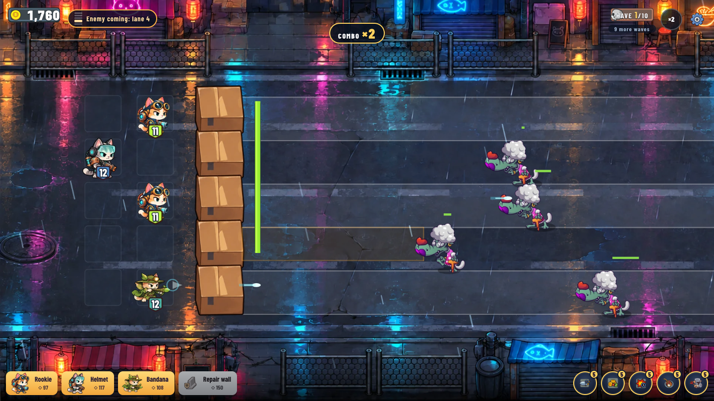

Merge preview on the drag label:

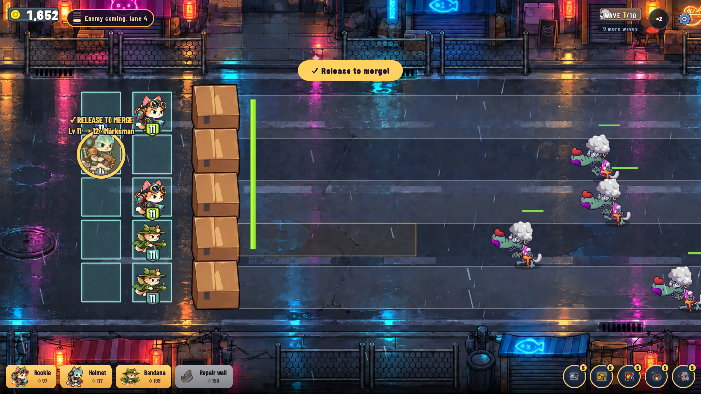

Last stand:

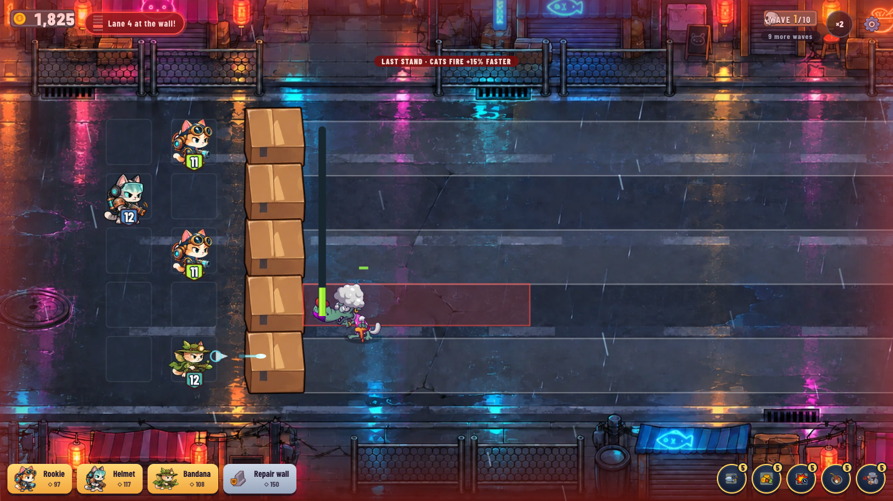

### Boss levels in play

Every fourth level ends with a boss on wave 10. The screens below come from the dev build with the fake wallet. To reach wave 10 for the captures, the wave counter and coins were set from the browser console, and for the Axel shot the combo label too. Art, HUD and boss behaviour are the normal game.

Boss alert, level 40:

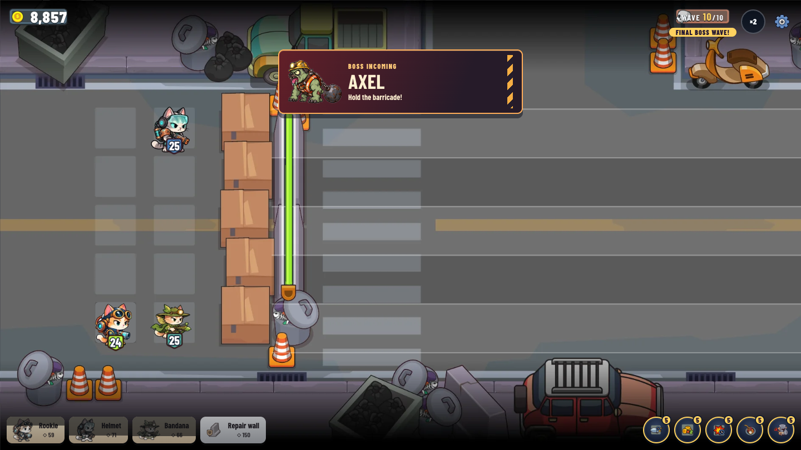

Axel at the wall, level 40:

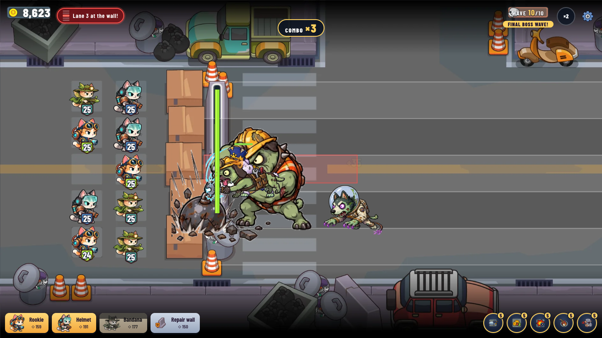

Rail Ratchet with escorts, level 28:

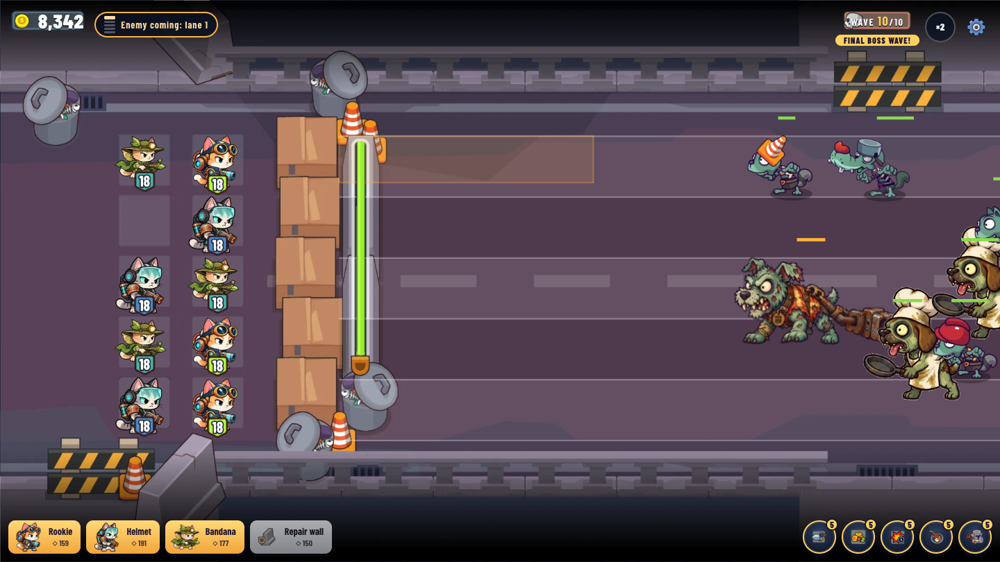

Final wave, level 60, Snowy Depot, at 844x390:

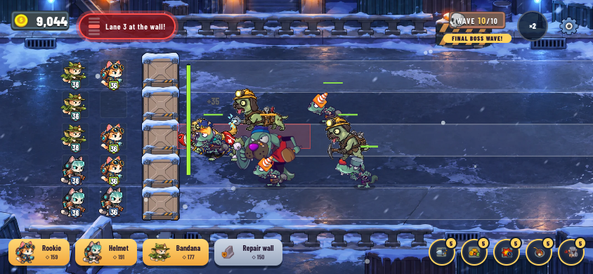

### Mobile web 

| Problem | Change |
| --- | --- |
| Bestiary button pushed off the side menu | Menu narrowed on low screens, with space kept for the notch |
| Send feedback button covered the last district label | Button moved to the top row, opposite the wallet chip |
| Side menu and wallet chip drew over modals | Modals render through a portal to `body`, with notch margins |
| Level sheet content cut off | Two-column layout on low screens: enemies on the left, squad and add-ons on the right |
| Dock blocked drags on lane 5 cells | Only the buttons take touches; the rest passes through to the board |
| Battle controls too large for a phone | Smaller deck cards, round add-on buttons with a count badge, coin counter moved to the top HUD |
| Browser bars take up screen space | Fullscreen switch in Settings where the browser supports it, and home screen app tags for iOS |
| JoyID cannot run from a home screen app | The wallet screen now detects this mode so it can explain it |

Screenshots from a phone on the public demo:

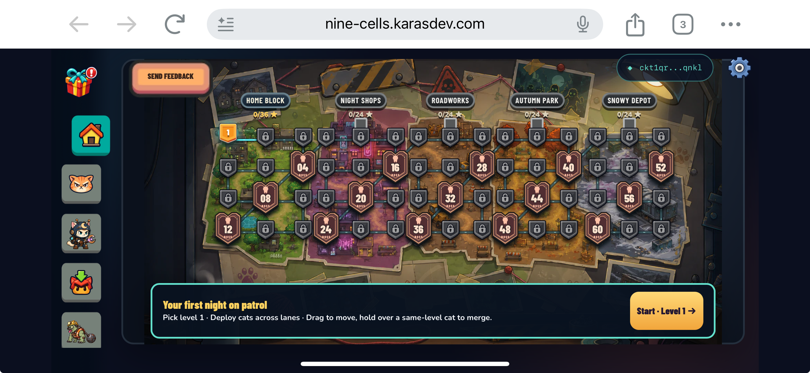
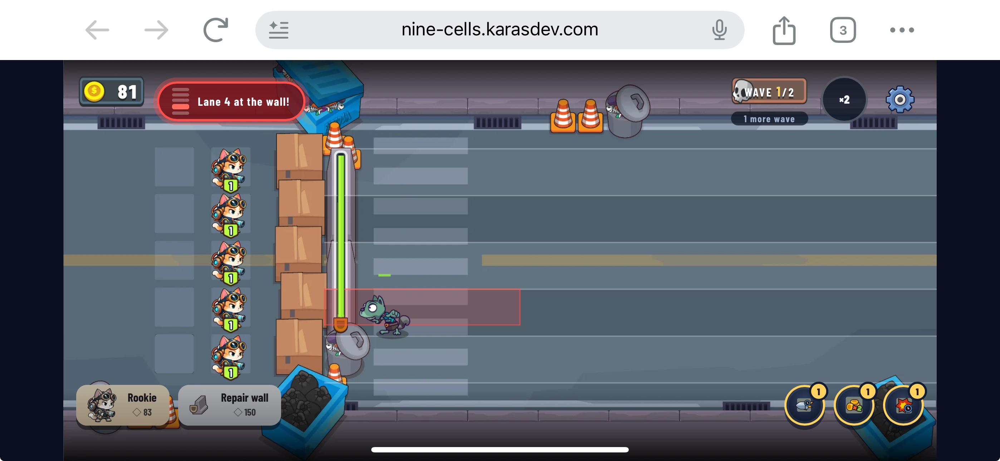
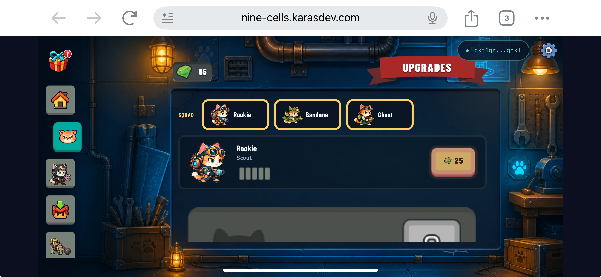
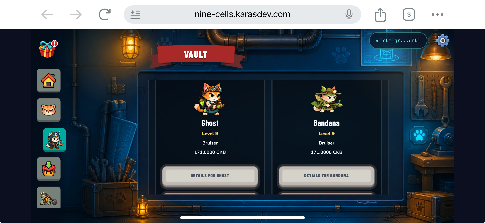
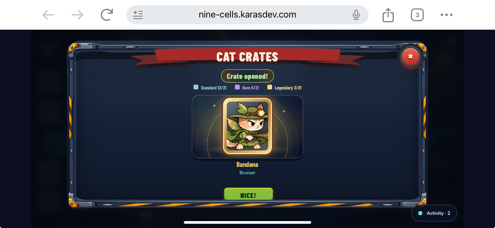

## 3. On chain

No new deploy. Since the v4 upgrade on 23 Oct, the indexer shows 5 mint and reveal pairs across 4 lock args on the CatCell type script.

| Transaction | Date (UTC+7) | Result |
| --- | --- | --- |
| [Mint `0xd8fa34b6…`](https://testnet.explorer.nervos.org/transaction/0xd8fa34b6101a22e3380d99cffe3d168241da6e530785be4ba090d86819b72400) | 1 Nov, 07:07 | Crate |
| [Reveal `0x90677004…`](https://testnet.explorer.nervos.org/transaction/0x9067700495d0dcc53bd0c28e2c14ee2f3ead87ae84a7931f14989ddde8512deb) | 1 Nov, 07:08 | Line 3 (Bandana), level 9, 171 CKB |
| [Reveal `0xbfbc5843…`](https://testnet.explorer.nervos.org/transaction/0xbfbc5843f1e2b7e77e42a6cfc9f8534368a182da42c2cabad218a07b86dc0c7c) | 25 Oct, 19:43 | Line 16, which is only valid under v4 (earlier versions stop at 15) |

## 4. Verification 

| Check | Result |
| --- | --- |
| Game tests on the current worktree | 490 passed, 8 skipped (real-node devnet tests) |
| Type check and production build | Passed |
| New battle tests | Combo reward, combo expiry, combo cap, unmerged penalty, last stand |
| Browser run with the fake wallet | Two real merges produced COMBO ×2; merge preview observed |
| Public demo | Bundle has the lane and mobile styles, plus combo logic |

Not on the demo or not committed: a tighter wallet and settings modal for screens under 390 px high is in the worktree only.

Not verified: Android. Last stand was triggered by setting wall HP for the capture.

#